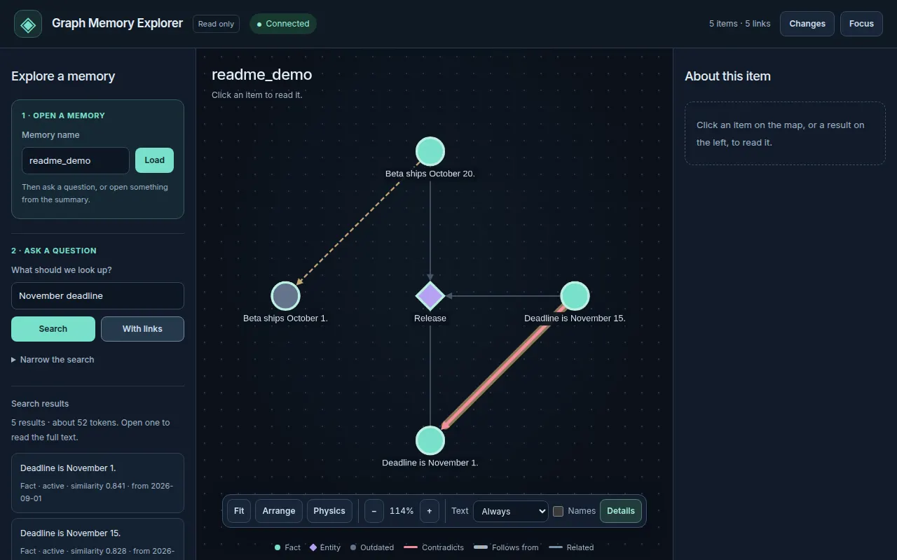
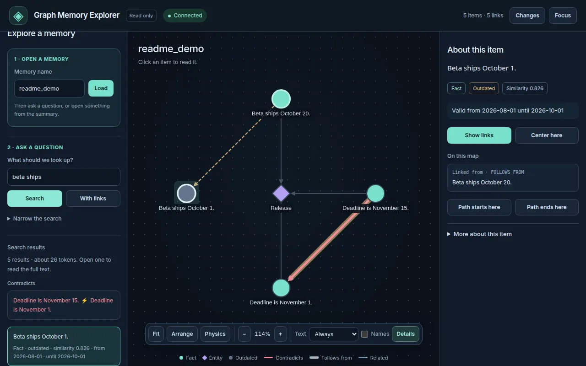
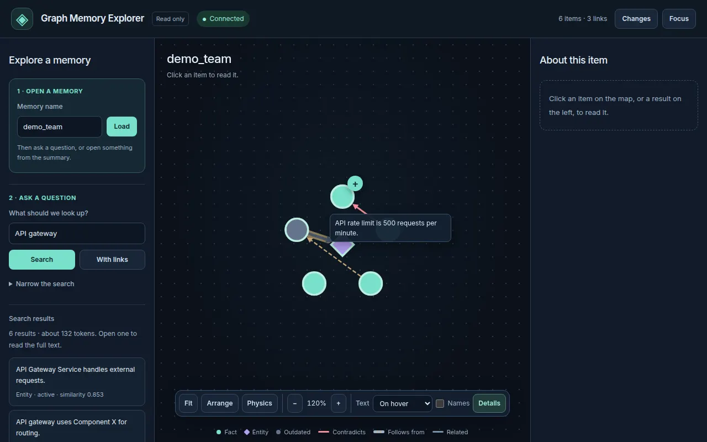

# Graph Memory MCP

<p align="center">
  <a href="https://github.com/river-ai-lab/graph-memory-mcp"></a>
  <a href="https://github.com/river-ai-lab/graph-memory-mcp/actions/workflows/ci.yml"></a>
  <a href="https://www.python.org/downloads/"></a>
  <a href="https://opensource.org/licenses/MIT"></a>
</p>

**Agent-friendly memory tools. Memory that outlives a chat session and is not tied to one model.**

Self-hosted MCP server for agent developers, teams running agents, and heavy agent users. You get tools shaped for agent work—warm up, search, write a fact, supersede a decision, walk connections—not a database admin surface. Agents decide what to write; the server keeps memory orderly (dedup on insert, outdated facts, contradictions the agent marked, physical per-owner isolation). Your data stays with you. No LLM calls on the server. Embeddings run locally.

<!-- Demo GIF: assets/demo/demo.gif (readme scenario). Seed first: assets/demo/seed.py -->

<p align="center">
  
</p>

The GIF above is a live recording of the `readme` scenario (seeded owner, then search / include_outdated / `get_node_change_history`). The write-cycle workflow below is the same tools; run it with `uv run python assets/demo/generate_demo.py --scenario sparse`. Other recordings: [docs/demos.md](docs/demos.md).

```bash
uv run graph-memory-mcp --host 127.0.0.1 --port 8000
uv run python assets/demo/seed.py
uv run python assets/demo/generate_demo.py --scenario readme
# full record → recall → replace → hide outdated → history:
uv run python assets/demo/generate_demo.py --scenario sparse
```

## Why Graph Memory MCP

- **Tools for agent tasks**: `get_brief` to warm up, `search` / `recall_context` to recall, `create_node` to record, `mark_outdated` to supersede, `get_context` / `get_trace` to walk links—named for what the agent is doing
- **Memory independent of the chat**: facts live on the server under an `owner_id`, so a later session, another client, or another model can recall what an earlier agent wrote
- **Current facts win**: `mark_outdated` hides superseded facts from default search; history is available when the agent asks for it
- **Write-time hygiene without a server LLM**: near-duplicates refused at insert (embeddings, threshold 0.92); physical isolation per `owner_id` (FalkorDB graph or ArcadeDB database)

Completeness depends on agent discipline: the server does not extract facts from chat logs. What was never written cannot be recalled.

## The workflow

Same tools, one owner. Steps 2+ are what a later session (or another agent) does.

### 1. Record a decision

```python
create_node(
    text="API gateway uses Component X for routing.",
    metadata={"project": "api", "created_by": "alice"},
    owner_id="team_backend",
)
# → {"node": {"node_id": "a1b2c3...", "text": "...", "status": "active"}}

create_relation(
    from_id="a1b2c3...",
    to_id="d4e5f6...",  # API Gateway Service
    relation_type="RELATED_TO",
    owner_id="team_backend",
)
```

### 2. Recall in another session

```python
get_brief(owner_id="team_backend")
search(query="API gateway component", owner_id="team_backend", compact=True)
# → current decision (Component X), while it is still active
```

### 3. Replace the decision

```python
new = create_node(
    text="API gateway migrated to Component Y (Oct 2026).",
    metadata={"project": "api", "created_by": "bob"},
    owner_id="team_backend",
)
new_id = new["node"]["node_id"]

mark_outdated(
    fact_id="a1b2c3...",
    reason="Migrated to Component Y",
    owner_id="team_backend",
)
create_relation(
    from_id=new_id,
    to_id="a1b2c3...",
    relation_type="FOLLOWS_FROM",
    owner_id="team_backend",
)
```

### 4. Default search hides the old fact

```python
search(query="API gateway component", owner_id="team_backend")
# → Component Y only. Component X is omitted unless include_outdated=true
```

### 5. History when asked

There is no single `what_changed(since=…)` tool yet. Ask for history explicitly with the tools that exist:

| Need | Call |
|------|------|
| Include superseded facts in search / context | `include_outdated=true` on `search`, `get_context`, or `recall_context` |
| Path from the new decision to the old one | `get_trace(from_id=new_id, to_id=old_id)` (often via `FOLLOWS_FROM`) |
| Snapshots of one node over time | `get_node_change_history(node_id)` and `get_node(node_id, as_of=…)` when writes used `versioning=true` (or `VERSIONING_DEFAULT`) |

`search(as_of=…)` is not implemented; see [Limitations](#limitations) and [roadmap](docs/roadmap.md).

**Contradictions** are agent-marked: create a `CONTRADICTS` edge; `search` returns those hits in `contradiction_pairs`. The server does not infer contradictions.

**Relation allowlist** (default 13, see [`relation_policy.py`](graph_memory_mcp/graph_memory/relation_policy.py)): `RELATED_TO`, `MENTIONS`, `SUMMARIZES`, `FOLLOWS_FROM`, `CONTRADICTS`, `EXTRACTED_FROM`, `SIMILAR_TO`, `NEXT_STEP`, `EXPOSES`, `CROSS_REF`, `RUNS_ON`, `USES`, `SERVED_BY`. Default mode: warn on unlisted types. `auto_link` writes `MENTIONS`.

## How agents should use this

- **Start every session** with `get_brief(owner_id)` → `search(query, compact=true)` for the task
- **Write one declarative fact per node**; no chat logs, no scratchpad, no secrets
- **Search before creating**; if `memory_duplicate` or `possible_duplicates` returned, do not write a third paraphrase
- **Fact became wrong** → `mark_outdated(fact_id, reason, owner_id=…)` + `create_node(new_text)`, not a silent overwrite
- **After meaningful work** (GROW): Ground what changed → Record it → Orient (tags/relations) → Write with `metadata.project` and `created_by`
- **Temporary notes** get `ttl_days` (14–30); durable decisions have no TTL
- **Link facts** with `create_relation` using the allowlist above

**Full policies**: [`docs/memory_policies_for_LLM.md`](docs/memory_policies_for_LLM.md) · [`docs/memory_policy_cheatsheet.md`](docs/memory_policy_cheatsheet.md) · operator constants in [`docs/AGENTS_example.md`](docs/AGENTS_example.md).

## Quickstart

```bash
cp env.example .env
docker compose up -d arcadedb  # Start ArcadeDB (default backend)
uv run graph-memory-mcp --host 127.0.0.1 --port 8000  # Start MCP server
claude mcp add --transport http graph-memory-mcp http://127.0.0.1:8000/mcp
```

See [full setup instructions](#setup) for Cursor and Claude Desktop.

**Learn more**: [Comparison](docs/comparison.md) · [FAQ](docs/memory_faq.md) · [Limitations](#limitations) · [Agent policy cheatsheet](docs/memory_policy_cheatsheet.md)

## Use cases

### Team architecture decisions

Alice stores “API gateway uses Component X.” Later Bob migrates to Component Y, calls `mark_outdated`, and links the new fact `FOLLOWS_FROM` the old. Any agent on that `owner_id` gets only the current fact by default. `include_outdated` or `get_trace` recovers the replacement story.

### Coding agent across sessions

The agent finds “staging database uses port 5433” and writes it with `create_node`. Next session (new chat, same owner) `search("staging database port")` retrieves it—memory is not the chat transcript.

### Multiple agents sharing memory

Write-time deduplication refuses near-paraphrases of the same fact. When two real decisions conflict, the agent creates a `CONTRADICTS` edge; search surfaces `contradiction_pairs`.

### Separate clients and projects

Each `owner_id` is a separate FalkorDB graph or ArcadeDB database—no shared tables, no query-time owner filter. Self-hosted: data stays on your infrastructure.

## When something else fits better

See [docs/comparison.md](docs/comparison.md) for Mem0, Graphiti, Zep, Letta, Cognee, and others.

## Limitations

- **No fact extraction on the server**: The agent decides what to write; raw chat logs are not auto-summarized (by design). Recall is only as complete as what agents wrote.
- **No `what_changed(since=…)` tool yet**: History is `include_outdated`, `get_trace` / `FOLLOWS_FROM`, and per-node versioning (`get_node_change_history`, `get_node(as_of)`). `search(as_of)` is planned in the roadmap.
- **Requires a running graph database**: ArcadeDB (default) or FalkorDB via Docker.
- **First model download is large**: the default fp32 ONNX weights for `intfloat/multilingual-e5-base` are about 1.1 GB. Quantized weights are not used. `EMBEDDING_BACKEND=torch` needs `uv sync --extra torch`.
- **Deduplication is similarity-based**: Near-duplicates are refused at insert using embeddings (threshold 0.92); may miss paraphrases below threshold or block distinct-but-similar facts.
- **Contradictions are not auto-detected**: The agent must create `CONTRADICTS` edges explicitly; they are surfaced in search results but not inferred by the server.
- **Owner access is `OWNER_SCOPE`**: `client` (default) uses the tool argument `owner_id`. `header` ignores it and reads `X-Owner-Id` (loopback bind; the gateway sends `Authorization: Bearer $ADMIN_TOKEN` when that token is set). `token` requires a Bearer API key; `owner_id` must be one of the key's projects, and an empty value uses the first project. There is no multi-tenant admin UI.


## Setup

**1. Configure environment**

```bash
cp env.example .env
```

The defaults work with `docker-compose.yml` (ArcadeDB: `root` / `playwithdata`, port 2480; FalkorDB: password `falkordb123`, port 6379).

**2. Start the database**

```bash
docker compose up -d arcadedb
```

This starts ArcadeDB (port 2480, default backend). To use FalkorDB instead, set `GRAPH_BACKEND=falkordb` in `.env` and run `docker compose up -d falkordb`.

**3. Install and run**

From this repository:

```bash
uv sync
uv run graph-memory-mcp --host 127.0.0.1 --port 8000
```

Without a clone, the same long-running process comes from PyPI:

```bash
pip install graph-memory-mcp
graph-memory-mcp --host 127.0.0.1 --port 8000
```

The default install embeds with ONNX Runtime (`EMBEDDING_BACKEND=onnx`). To use the previous sentence-transformers path: `uv sync --extra torch` and set `EMBEDDING_BACKEND=torch`.

The server is now at `http://127.0.0.1:8000/mcp` (Streamable HTTP MCP).

**4. Configure your MCP client**

Add this to your MCP configuration file:

**Claude Code (CLI)**:

```bash
claude mcp add --transport http graph-memory-mcp http://127.0.0.1:8000/mcp
```

**Claude Desktop** (`~/Library/Application Support/Claude/claude_desktop_config.json` on macOS, `%APPDATA%\Claude\claude_desktop_config.json` on Windows):

Claude Desktop launches only local (stdio) servers from `claude_desktop_config.json`, so bridge to the HTTP server with `mcp-remote`:

```json
{
  "mcpServers": {
    "graph-memory-mcp": {
      "command": "npx",
      "args": ["-y", "mcp-remote", "http://127.0.0.1:8000/mcp"]
    }
  }
}
```

**Cursor** (`~/.cursor/mcp.json`):

```json
{
  "mcpServers": {
    "graph-memory-mcp": {
      "url": "http://127.0.0.1:8000/mcp"
    }
  }
}
```

See [examples/mcp_servers_config.json](examples/mcp_servers_config.json) for clients that read an mcpServers dict with a transport key (e.g. langchain-mcp-adapters).

**5. Test**

```bash
uv run python examples/http_client_usage.py
```

With `mcp>=2.3` the Python client is `mcp.client.streamable_http.streamable_http_client` (the old `streamablehttp_client` name is gone). Pass headers such as `Authorization` through an `httpx.AsyncClient`: `streamable_http_client(url, http_client=httpx.AsyncClient(headers=...))`.

## Agent tools (by task)

| Task | Tools |
|------|--------|
| Warm up / project state | `get_brief` |
| Recall for the task | `search` (`compact=true`), `recall_context` |
| Record a fact | `create_node` / `upsert_node` (near-duplicates refused at 0.92) |
| Supersede a fact | `mark_outdated` + `create_node`; optional `FOLLOWS_FROM` |
| Walk connections | `get_context`, `get_trace` |
| History on request | `include_outdated=true`; `get_node_change_history` / `get_node(as_of)` when versioning was used |
| Mark a conflict | `create_relation(..., CONTRADICTS)` → `contradiction_pairs` on search |

Also: entity/triplet helpers (`create_triplet`, `search_triplets`), TTL facts (hidden until `include_ttl=true`), opt-in `auto_link`, background jobs when `JOBS_ENABLED=true`. ArcadeDB (default) or FalkorDB (`GRAPH_BACKEND=falkordb`) — same tools.

## Documentation

- **[Comparison](docs/comparison.md)** — how this differs from Mem0, Graphiti, Letta, and others
- **[Agent policies](docs/memory_policies_for_LLM.md)** — what agents should store and how (load this in every session)
- **[API contract](docs/features.md)** — tool signatures and data model
- **[FAQ](docs/memory_faq.md)** — common questions and operational guidance

## Configuration

Settings are loaded from `.env` and environment variables. Defaults are in `graph_memory_mcp/config.py`.

Key settings:

- `GRAPH_BACKEND` — `arcadedb` (default) or `falkordb`
- `EMBEDDING_BACKEND` — `onnx` (default) or `torch` (optional extra)
- `EMBEDDING_MODEL` — default `intfloat/multilingual-e5-base`
- `RELATION_POLICY_ENFORCE` — `off` | `warn` (default) | `enforce`
- `RELATION_ALLOWED_TYPES` — comma-separated edge type allowlist
- `OWNER_SCOPE` — `client` (default), `header`, or `token`. See [Owners](#owners).
- `JOBS_ENABLED` — `false` by default; enable for archive and dedup background jobs

See `env.example` for all options. Details: [configuration](docs/configuration.md).

## Owners

The same server has three ways to choose `owner_id`. `client` stays the default, so a one-minute install does not change.

| Mode | Who chooses the owner | When to use it |
|------|------------------------|----------------|
| `client` | The tool argument `owner_id` | Trusted local or company deploy. Anyone who can call the server can name any owner. |
| `header` | `X-Owner-Id`, set by your gateway. The tool argument is ignored. The gateway sends `Authorization: Bearer $ADMIN_TOKEN` when that token is set. | The server listens on `127.0.0.1`. The gateway is the only client. |
| `token` | The API key's `projects`. `owner_id` must be one of them; omit it to use the first. | A small team on one process. No second service. |

An API key is a person's `name` plus the owner graphs (`projects`) they may use. Team setup: [docs/team-setup.md](docs/team-setup.md).

Token mode:

```bash
uv run graph-memory-mcp keys create --name alice --projects p1,p2
```

The command prints the key once. `keys.json` keeps the sha256 hash, name, and projects. Then:

```bash
OWNER_SCOPE=token
API_KEYS_FILE=./keys.json
```

A missing, unknown, or revoked key is HTTP 401. An `owner_id` that is not in the key's projects is HTTP 403 (or a tool error with `memory_forbidden`). `graph-memory-mcp keys set-projects <id> p1,p3` replaces the list. `keys list` prints id, name, projects, and created time, never the key. `keys revoke <id>` revokes by id. In token mode every write stores the key's `name` as `created_by` / `updated_by`. In `client` and `header` those fields come from `metadata.created_by` / `metadata.updated_by`. Jobs keep the owner they were started with.

`graph-memory-mcp --auth` is the token entry point (`server_auth.py`). It forces `OWNER_SCOPE=token` and refuses to start without `ADMIN_TOKEN`. Tool schemas omit `owner_id`; the server uses the key's first project. Issue keys with `keys create`, inspect them with `keys list`, and revoke with `keys revoke`. The default server is unchanged: set `OWNER_SCOPE=token` there when the agent must pass `owner_id` to choose among a key's projects.

Token mode does not start without `ADMIN_TOKEN` and a readable keys file. `/admin` takes the owner from the path, so in this mode it always requires that token. `client` and `header` still leave `/admin` open when `ADMIN_TOKEN` is empty.

Header mode belongs on `127.0.0.1`, with the gateway as the only client. The gateway sends `Authorization: Bearer $ADMIN_TOKEN` and `X-Owner-Id`. `/mcp` returns HTTP 401 when that token is set and the bearer is missing or wrong. Without `ADMIN_TOKEN`, the process starts on `127.0.0.1`, `::1`, or `localhost` only. Any other bind address exits. `ALLOW_INSECURE_HEADER=1` logs a warning and starts anyway.

`client` mode has no `/mcp` authentication, so it starts on loopback only. A bind such as `0.0.0.0` exits unless `ALLOW_INSECURE_CLIENT=1` is set (it logs a warning). For network access use `OWNER_SCOPE=token`.

`/internal/graph-size` in `client` and `header` requires `ADMIN_TOKEN` plus `X-Owner-Id`. `token` requires the API key; `X-Owner-Id` must be one of the key's projects, or the first project is used. `/metrics` stays open in every mode: handler, cache, and job counters, plus totals summed across owners. It does not name an owner.

## Running the databases

### ArcadeDB

```bash
cp env.example .env
docker compose up -d arcadedb
```

ArcadeDB runs on port 2480. Default credentials: `root` / `playwithdata`. Minimum version: 26.10 (the compose file pins `26.10.2`). 25.10.1 fails with `Index type 'LSM_VECTOR' is not supported`.

Test with ArcadeDB:

```bash
GRAPH_BACKEND=arcadedb uv run pytest -m arcade
```

### FalkorDB

To use FalkorDB instead of ArcadeDB, set `GRAPH_BACKEND=falkordb` in `.env`. Runs on port 6379, web UI at http://localhost:3000. Default password: `falkordb123`.

```bash
docker compose up -d falkordb
```

Test with FalkorDB:

```bash
GRAPH_BACKEND=falkordb uv run pytest -m "not arcade" -q
```

Test with ArcadeDB (default):

```bash
GRAPH_BACKEND=arcadedb uv run pytest -m arcade -q
```

### Vector indexes

The server uses two vector indexes (Fact and Entity). The first write for an owner creates both, and later writes reuse that per-owner cache. They are also created on `search`, `find_similar`, or Fact `auto_link` when missing, or when `AUTO_CREATE_INDEXES=true` is set.

**Changing the embedding model invalidates the stored corpus.** You must re-embed every node after changing `EMBEDDING_MODEL`, its dimension, or `EMBEDDING_QUERY_PREFIX` / `EMBEDDING_PASSAGE_PREFIX`. See [Embeddings](docs/configuration.md#embeddings).

## Server profiles

Profiles with the same tools; agents pick one and stay on it:

| Profile | Start | Provenance |
|---------|-------|------------|
| Default | `graph-memory-mcp` | Nested `source` object |
| Simple | `graph-memory-mcp --simple` | Flat (`ref`, `provenance_type`, `source_updated_at`, …); `upsert_node` requires `ref` |
| Extended | `graph-memory-mcp --extended` | Same as default, plus `description`, `shared_with_ids`, `collection_id`, and node types `Collection`, `User`, `Project` |
| Auth | `graph-memory-mcp --auth` | Same as default. `OWNER_SCOPE=token`. Schemas omit `owner_id`; the server uses the key's first project. |

See [docs/features.md](docs/features.md) for details.

## Graph Explorer

Local read-only web UI. **Open a memory**: enter a memory name and click **Load**, then search under **Ask a question** or open an item from the summary. An empty name shows "Enter a memory name, then click Load." and does not open `default`. **More tools** covers open by ID, find a path, similar wording, and how far to look. The toolbar is Fit, Arrange, Physics, zoom, text preview, **Names**, and **Details**. The map legend shows facts, entities, outdated items, contradicts, follows-from, and related. Details lead with the text, status, and validity. Timestamps, the id, and raw fields are under **More about this item**. Node text on the map is **On hover** by default, or **Always** (one short line). Always-mode labels hide when the map is zoomed out. The choice is stored in `localStorage` as `gm_node_preview`. The summary counts outdated facts. With `--auth`, the memory name shows the key's project and cannot be edited.

The shots below are `readme_demo` from [`assets/demo/seed.py`](assets/demo/seed.py) and the dense demo owner `demo_team`. Regenerate them with `node scripts/explorer_screenshots.mjs` while Explorer is running.







```bash
# Terminal 1 — MCP server
uv run graph-memory-mcp --host 127.0.0.1 --port 8000

# Terminal 2 — Explorer
uv run graph-memory-explorer --host 127.0.0.1 --port 8088
```

Open http://127.0.0.1:8088. Against `graph-memory-mcp --auth`:

```bash
GRAPH_MEMORY_API_KEY=<key> uv run graph-memory-explorer --auth --host 127.0.0.1 --port 8088
```

The owner field is then bound by the key. `--token` is the same as the env var.

## Multi-agent usage

Use `owner_id` to isolate or share memory:

- **Shared team memory**: both `agent_codegen` and `agent_debug` use `owner_id="team_platform"` and share all facts
- **Isolated per-agent**: `agent_codegen` uses `owner_id="agent_codegen"`, `agent_docs` uses `owner_id="agent_docs"`; neither sees the other's memory

Each `owner_id` lives in its own graph (FalkorDB) or database (ArcadeDB). Queries do not see other owners.

**Owner ID charset**: both backends accept `[A-Za-z0-9_@-]+`. `ARCADE_DATABASE` must match `^[A-Za-z][A-Za-z0-9_]*$`. Each ArcadeDB owner is an unquoted database `{ARCADE_DATABASE}_{owner_id}`.

See [docs/memory_policies_for_LLM.md](docs/memory_policies_for_LLM.md) for agent-facing guidance.

## Persistence and backups

### ArcadeDB

Data is the Docker volume `arcade-data` (the image user cannot write a root-owned `./data-arcade` bind). `docker compose down` keeps it; `docker compose down -v` deletes it. ArcadeDB admin endpoints support export/import:

```bash
# Export a database (requires authentication)
curl -u root:playwithdata http://localhost:2480/api/v1/export/memory_demo > backup.jsonl.gz

# Import (see ArcadeDB docs)
curl -u root:playwithdata -X POST http://localhost:2480/api/v1/import/memory_demo -F file=@backup.jsonl.gz
```

### FalkorDB

`docker-compose.yml` enables AOF persistence (`--appendonly yes --appendfsync everysec`). A container crash loses at most one second of writes.

Point-in-time backups:

```bash
./scripts/backup.sh
```

This runs `BGSAVE` and copies `dump.rdb` to `./backups` (keeps last 14).

### Logical per-owner backups (both backends)

Portable across instances:

```bash
curl http://127.0.0.1:8000/admin/export/{owner_id}
```

Supports `?limit=&offset=&section=nodes|relations` for large graphs. Restore with `POST /admin/import`.

**ArcadeDB backups**: Data persists in the `arcade-data` volume. For a point-in-time copy, stop ArcadeDB and archive that volume. Logical export/import via the admin API works across backends.

## Development

### Tests

Default tests require FalkorDB running:

```bash
./scripts/test.sh
# or: docker compose up -d && uv run pytest -q
```

ArcadeDB tests:

```bash
uv run pytest -m arcade
```

Headless Explorer smoke (FalkorDB only). Skipped unless `EXPLORER_BROWSER=1`. Needs Explorer at `EXPLORER_URL` (default `http://127.0.0.1:8088`). The auth check uses `EXPLORER_AUTH_URL` (default `http://127.0.0.1:8091`) for an Explorer started with `--auth`. Playwright loads from `PLAYWRIGHT_MODULE` or `/tmp/node_modules/playwright/index.mjs`. CI excludes the marker (`not arcade and not browser`, and `arcade and not browser`).

```bash
EXPLORER_BROWSER=1 uv run pytest -q -m browser
```

### Pre-commit hooks

Hooks run via the project venv:

```bash
uv run pre-commit run --all-files
uv run pre-commit install   # optional git hooks
```

## Status and roadmap

### Stable

These features are tested and in active use:

- Core agent workflow (`create_node`, `search`, `mark_outdated`, relations, `get_context`, `get_brief`; history via `include_outdated` / versioning tools)
- Physical per-owner isolation (ArcadeDB databases, FalkorDB graphs)
- Write-time deduplication (embeddings, threshold 0.92)
- Vector search with hybrid ranking (cosine + identifier match + recency)
- Server profiles (default, `--simple`, `--extended`, `--auth`)
- TTL facts excluded from default search
- MCP over Streamable HTTP
- Compact recall with token budget

### Experimental

- Background jobs (deduplication, archival) when `JOBS_ENABLED=true`
- Versioning snapshots (`get_node as_of`, requires `versioning=true` on writes)
- Fact auto-linking (`auto_link=true` adds `MENTIONS` to similar entities)

See [docs/roadmap.md](docs/roadmap.md) for planned features and [CHANGELOG.md](CHANGELOG.md) for recent changes.

## Contributing

See [CONTRIBUTING.md](CONTRIBUTING.md) for development setup, testing guidelines, and pull request process.

## License

MIT — see [LICENSE](LICENSE)
