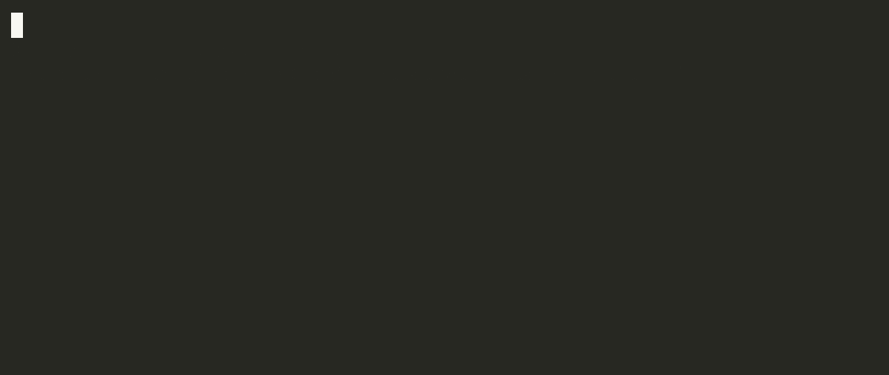

# Other demos

Start the server with `uv run graph-memory-mcp --host 127.0.0.1 --port 8000`. Each GIF is a recording of the command under it, against that server. The README GIF is the seeded contradiction clip and is not repeated here.

## Dense

<p align="center">
  
</p>

The script runs the gateway story in one session: links, a search miss then a write-back, `mark_outdated`, `FOLLOWS_FROM`, a `CONTRADICTS` edge it creates between two rate limits, and a near-duplicate the server refuses.

```bash
uv run python assets/demo/generate_demo.py --scenario dense
```

The scenario clears owner `demo_team` and builds the story as it runs. Script: [assets/demo/generate_demo.py](../assets/demo/generate_demo.py).

## Contradictions

<p align="center">
  
</p>

Search returns both rate-limit facts and the `CONTRADICTS` edge the seed script created.

```bash
uv run python assets/demo/generate_demo.py --scenario seed
uv run python assets/demo/generate_demo.py --scenario contradictions
```

`--scenario seed` resets owner `demo_team` and is not in the GIF. Script: [assets/demo/generate_demo.py](../assets/demo/generate_demo.py).

## Lifecycle

<p align="center">
  
</p>

Search returns Component Y and leaves outdated Component X out, then the server refuses a near-duplicate of Component Y.

```bash
uv run python assets/demo/generate_demo.py --scenario seed
uv run python assets/demo/generate_demo.py --scenario lifecycle
```

Same seed as the contradictions clip. Script: [assets/demo/generate_demo.py](../assets/demo/generate_demo.py).

## Retrieval

<p align="center">
  
</p>

Search returns the current gateway decision, then `get_context` shows the API Gateway Service linked to it.

```bash
uv run python assets/demo/generate_demo.py --scenario seed
uv run python assets/demo/generate_demo.py --scenario retrieval
```

Same seed as the contradictions clip. Script: [assets/demo/generate_demo.py](../assets/demo/generate_demo.py).

## Inspector CLI

<p align="center">
  
</p>

The Inspector CLI saves "API gateway uses Component Y", then search returns that fact.

```bash
curl -s -X DELETE http://127.0.0.1:8000/admin/owners/default
./assets/demo/cli_demo.sh
```

The delete clears owner `default` and is not in the GIF. Script: [assets/demo/cli_demo.sh](../assets/demo/cli_demo.sh).
